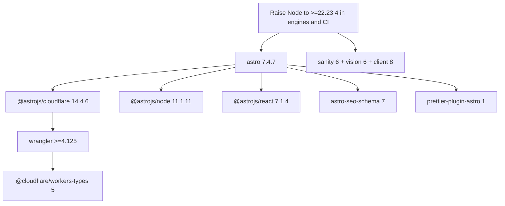

# Major dependency migration report — 2026-11-06

**Scope:** Direct dependencies across `web-chambreasoi.fr`, `studio-chambreasoi.fr`, and `@chambreasoi/sanity`.  
**Policy:** In-range patch/minor updates that passed the changelog gate were applied. Majors, 0.x breaking minors, and in-range minors with documented breaks were **not** installed. This report validates those deferred upgrades against this repo.

**Applied safely today:** see summary at the end.  
**Not installed:** everything in the clusters below.

---

## Decision matrix

| Cluster | Installed | Latest considered | Verdict |
| --- | --- | --- | --- |
| Astro 7 stack | `astro@6.4.8` + adapters on 13/10/5 | `astro@7.4.7` + cloudflare 14 / node 11 / react 7 | **No-go** until Node floor and peer closure move together |
| Sanity 6 | `sanity@5.31.2`, vision/icons on v5/v3, client 7.28 | `sanity@6.22.0`, vision 6, client 8, icons 5 | **Conditional go** — low schema risk; schedule after Astro/Node decision |
| TypeScript 7 | web/studio `6.0.3`; sanity pkg `5.9.3` | `7.0.2` | **No-go** — `@astrojs/check` peers only `^5 \|\| ^6`; TS 7 ships without compiler API |
| Vitest 5 | `4.1.12` | `5.1.0` | **Defer** — workable later; review mock/clearMocks defaults |
| Wrangler + workers-types 5 | wrangler `4.107.1` exact; types `4.20260702.1` | wrangler `4.158.0` + types `5.x` | **No-go alone** — required by Astro Cloudflare 14; treat as one move with Astro 7 |
| sharp 0.35 | `0.34.5` | `0.35.5` | **Defer** — caret cannot reach 0.35; several API breaks |
| Biome 2.6 (deferred minor) | `~2.6.5` | `2.6.5` | **Applied** — `biome migrate` + exclude md/svg/`.agents` |
| vanilla-calendar-pro 3.4 (deferred minor) | `~3.4.0` | `3.4.0` | **Applied** — register `annotations` for `popups` |
| `@types/node` 26 | `22.20.5` | `26.6.6` | **No-go** — engines still Node 22 |
| prettier-plugin-astro 1 | `0.14.1` | `1.1.2` | Bundle with Astro 7 |
| astro-seo-schema 7 | `6.0.0` | `7.0.1` | Bundle with Astro 7; peer conflict on `schema-dts` |
| `@sanity/eslint-config-studio` 7 | `6.0.0` | `7.0.0` | Bundle with Sanity 6 / ESLint peer fix |



---

## 1. Astro 7 stack

### Versions

| Package | Installed | Latest | Notes |
| --- | --- | --- | --- |
| `astro` | 6.4.8 | 7.4.7 | engines: Node `>=22.23.4` |
| `@astrojs/cloudflare` | 13.7.0 | 14.4.6 | peers `astro@^7.4.0`, `wrangler@^4.125.0` |
| `@astrojs/node` | 10.1.4 | 11.1.11 | peers `astro@^7.2.1` (dev adapter in `astro.config.mjs`) |
| `@astrojs/react` | 5.0.7 | 7.1.4 | engines Node `>=22.23.4` |
| `@astrojs/sitemap` | 3.7.4 | 3.7.4 | No Astro peer published; docs still current for Astro 7 — keep 3.7.4 and re-verify on upgrade |
| `@astrojs/check` | 0.9.12 | 0.9.12 | peers `typescript@^5 \|\| ^6` only |
| `prettier-plugin-astro` | 0.14.1 | 1.1.2 | Major 0→1; peers Prettier `^3.5.3` (already satisfied) |
| `astro-seo-schema` | 6.0.0 | 7.0.1 | peers `astro@^7`, `schema-dts@^1.1.0` while repo uses `schema-dts@2.1.0` |

### Upgrade guide / changelog

- Guide: https://docs.astro.build/en/guides/upgrade-to/v7/
- Announcement: https://astro.build/blog/astro-7/
- Recommended CLI: `npx @astrojs/upgrade`

### Breaking changes that matter here

1. **Node floor.** Astro 7.4.x requires Node `>=22.23.4`. Root [`package.json`](../../package.json) engines are `>=22.12.0`; CI [`.github/workflows/security-ci.yml`](../../.github/workflows/security-ci.yml) uses `node-version: 22` (floating latest 22.x — confirm runners are ≥22.23.4 before cutting over).
2. **Vite 8.** Bundler upgrade; most app code is fine, but custom Vite plugins need a Vite 8 pass.
3. **Rust compiler default.** Stricter: unclosed tags error; invalid HTML is no longer auto-fixed. Audit `.astro` templates after upgrade.
4. **`src/fetch.ts` reserved** for advanced routing. This repo has **no** `web-chambreasoi.fr/src/fetch.ts` — clear.
5. **Markdown → Sätteri.** Default Markdown pipeline changed. Site is mostly `.astro` + Sanity content; low risk unless remark/rehype plugins appear later. Keep `@astrojs/markdown-remark` only if remark plugins are required.
6. **Adapter + tooling lockstep.** Cloudflare adapter 14 forces Wrangler ≥4.125, which forces `@cloudflare/workers-types@5`. Dev uses `@astrojs/node` in [`astro.config.mjs`](../../web-chambreasoi.fr/astro.config.mjs) — must bump to 11 with Astro 7.

### Repo files to touch on upgrade

- [`web-chambreasoi.fr/package.json`](../../web-chambreasoi.fr/package.json) — astro, adapters, react integration, prettier-plugin-astro, astro-seo-schema, wrangler, workers-types
- [`web-chambreasoi.fr/astro.config.mjs`](../../web-chambreasoi.fr/astro.config.mjs) — adapter switch, integrations
- [`web-chambreasoi.fr/src/layouts/Head.astro`](../../web-chambreasoi.fr/src/layouts/Head.astro) — `astro-seo-schema` / `schema-dts` peer mismatch (schema-dts 2 vs seo-schema peer `^1`)
- Root engines + CI Node version
- Exact `wrangler` pin in web + studio (today `4.107.1`)

### Verdict: **No-go (now)**

Blocked by Node engines/CI policy and the Cloudflare/Wrangler/types peer chain. When ready: raise Node, run `@astrojs/upgrade`, bump Wrangler+types together, resolve `astro-seo-schema` vs `schema-dts` peer, then full `pnpm build:web` + deploy preview.

---

## 2. Sanity 6

### Versions

| Package | Installed | Latest |
| --- | --- | --- |
| `sanity` (web + studio) | 5.31.2 | 6.22.0 |
| `@sanity/vision` | 5.31.2 | 6.22.0 (peers `sanity@^6.22.0`) |
| `@sanity/client` (web + `@chambreasoi/sanity`) | 7.28.0 | 8.14.1 |
| `@sanity/icons` | 3.8.0 | 5.2.3 (skips 4) |
| `@sanity/astro` | 3.6.0 | 3.6.0 already allows Sanity 6 + client 8 |
| `@sanity/eslint-config-studio` | 6.0.0 | 7.0.0 (peers ESLint 10; Node `^22.13 \|\| >=24`) |

### Upgrade guide / changelog

- Guide: https://www.sanity.io/docs/help/v5-to-v6
- Blog: https://www.sanity.io/blog/sanity-studio-v6
- Client changelog: https://github.com/sanity-io/client/blob/main/CHANGELOG.md

### Breaking changes vs this repo

1. **Node ≥22.12** — already met by root engines; local Node 25 is fine.
2. **React strict mode on in Studio dev** — schemas/plugins in [`studio-chambreasoi.fr/sanity.config.ts`](../../studio-chambreasoi.fr/sanity.config.ts) and [`web-chambreasoi.fr/sanity.config.ts`](../../web-chambreasoi.fr/sanity.config.ts) use structure + singletons; no custom auth. Expect to smoke-test `pnpm --filter studio-chambreasoi-fr dev` under strict mode (or temporarily `reactStrictMode: false` in CLI config).
3. **`auth.providers` / `auth.mode`** — not used here. Clear.
4. **Default search `groq2024`** — editorial UX change only; content APIs unchanged.
5. **Vite 8 under Studio** — only matters if `sanity.cli` custom Vite config exists (none found beyond defaults).
6. **Client 8** — engines Node `>=22.12`; update both web and `@chambreasoi/sanity` together so fetch helpers stay aligned.

### Verdict: **Conditional go**

Schema/config risk is low. Prefer doing Sanity 6 **after** or **with** the Node floor raise used for Astro 7, and bump `sanity` + `@sanity/vision` + `@sanity/client` + `@sanity/icons` + eslint-config-studio in one PR. `@sanity/astro@3.6.0` can stay.

---

## 3. TypeScript 7

### Versions

| Workspace | Installed | Latest 6.x / 7.x |
| --- | --- | --- |
| web + studio | 6.0.3 | latest 6.x is 6.0.3; latest overall 7.0.2 |
| `@chambreasoi/sanity` | 5.9.3 (`^5.8`) | Align to 6.0.3 is a **manifest major** for that package |

### Upgrade guide

- https://devblogs.microsoft.com/typescript/announcing-typescript-7-0/
- TypeScript 6 deprecations become hard errors in 7

### Blockers in this repo

1. **`@astrojs/check@0.9.12` peers `typescript@^5 \|\| ^6` only** — installing TS 7 breaks `astro check` peer resolution.
2. **TypeScript 7.0 does not ship the compiler API** — tooling that loads `typescript` as a library (language services, some Astro/editor paths) may need to stay on 6 via `@typescript/typescript6` until 7.1+.
3. **`@chambreasoi/sanity` still on TS 5** — recommend a dedicated minor PR to move that package to `typescript@^6.0.3` before any TS 7 attempt, so the monorepo is consistent on 6.

### Verdict: **No-go**

Stay on TypeScript 6.0.3 for web/studio. Optionally align `@chambreasoi/sanity` to 6.0.3 in a follow-up (major for that package.json range). Revisit TS 7 when `@astrojs/check` peers include 7 and editor tooling supports the new API.

---

## 4. Vitest 5

### Versions

- Installed: `4.1.12` (web + `@chambreasoi/sanity`)
- Latest: `5.1.0`
- Guide: https://vitest.dev/guide/migration/

### Breaking changes relevant here

- Requires Vite `>=6.4` and Node `>=22.12` (Node OK).
- `clearMocks` defaults to `true`.
- `vi.mock` / `vi.unmock` / `vi.hoisted` must be top-level (throws if nested).
- Bench API rewrite (not used here).
- Artifacts under `.vitest/`.

### Repo surfaces

- [`web-chambreasoi.fr/vitest.config.ts`](../../web-chambreasoi.fr/vitest.config.ts) — alias-only config; should migrate cleanly
- Web: 16 test files / 60 tests; sanity package: 3 tests — re-run full suite after bump

### Verdict: **Defer (low urgency)**

Safe to schedule as an isolated PR after reviewing mock call-count assertions. Not blocking production.

---

## 5. Wrangler past 4.107.1 + workers-types 5

### Versions

| Package | Capped now | Latest |
| --- | --- | --- |
| `wrangler` | **4.107.1** exact (web + studio) | 4.158.0 |
| `@cloudflare/workers-types` | 4.20260702.1 | 5.20261106.1 |

### Why capped

- Last Wrangler that peers types **v4**: `4.107.1` (`^4.20260702.1`)
- First Wrangler that peers types **v5**: `4.108.0`
- `@astrojs/cloudflare@14` requires `wrangler@^4.125.0` → forces the types-5 line

### Verdict: **No-go alone**

Do not float Wrangler with a caret. Keep the exact pin until the Astro 7 / Cloudflare 14 migration. Then bump Wrangler ≥4.125 and workers-types 5 in the same PR as the adapter.

---

## 6. sharp 0.35

### Versions

- Installed: `0.34.5` (`^0.34.5` cannot select 0.35)
- Latest: `0.35.5`
- Changelog: https://sharp.pixelplumbing.com/changelog/v0.35.0/

### Breaking highlights

- Node ≥20.9 (OK here)
- Removed install script; optional source build / WASM fallback
- Removed `failOnError`, deprecated `sharpen` props, `paletteBitDepth`
- `format.jp2k` → `format.jp2`
- AVIF quality metric change; `limitInputChannels` default 5

### Repo usage

- Build-time image service only in [`astro.config.mjs`](../../web-chambreasoi.fr/astro.config.mjs) (`astro/assets/services/sharp`). Workers do not run sharp at runtime.

### Verdict: **Defer**

Explicit range bump to `^0.35.5` after a production image build smoke test. Low app-code risk if no direct sharp API calls; still treat as breaking because of 0.x semver and install/binary behavior.

---

## 7. Deferred in-range minors (changelog gate)

### Biome `2.5.15` → `2.6.5`

- Blog: https://biomejs.dev/blog/biome-v2-6/
- Breaks: removes `javascript.parser.gritMetavariables`; renames `useSortedClasses` → `useTailwindSortedClasses`; Tailwind v4 sort semantics.
- Current [`biome.json`](../../web-chambreasoi.fr/biome.json) does **not** use the removed keys, but new language coverage (Markdown/YAML/etc.) can change `biome check` noise.
- **Next step:** `biome migrate --write`, update `$schema`, then bump to 2.6.5 in a dedicated PR.

### vanilla-calendar-pro `3.3.2` → `3.4.0`

- Migration: https://github.com/uvarov-frontend/vanilla-calendar-pro/wiki/Migration-from-v3.3.2-to-v3.4.0
- ESM must register extensions. This site uses `popups` in [`AvailabilityCalendar.astro`](../../web-chambreasoi.fr/src/components/availabily-page/AvailabilityCalendar.astro) → needs `annotations`.
- Minimal code change:

```ts
import { Calendar, annotations } from "vanilla-calendar-pro";
// ...
new Calendar(element, { ...calendarOptions, extensions: [annotations] });
```

---

## 8. Other majors left for their clusters

| Package | Installed | Latest | Follow |
| --- | --- | --- | --- |
| `@types/node` | 22.20.5 | 26.6.6 | Stay on 22 while engines are Node 22 |
| `prettier-plugin-astro` | 0.14.1 | 1.1.2 | With Astro 7 |
| `astro-seo-schema` | 6.0.0 | 7.0.1 | With Astro 7; resolve `schema-dts` peer (`^1` vs installed 2) |
| `@sanity/eslint-config-studio` | 6.0.0 | 7.0.0 | With Sanity 6; today peers ESLint ^9 while studio has ESLint 10.14 |

---

## Recommended upgrade order (future PRs)

1. ~~**Optional hygiene:** `@chambreasoi/sanity` → TypeScript 6.0.3; Biome 2.6 + migrate; vanilla-calendar-pro 3.4 + `annotations`.~~ **Done (2026-11-06 follow-up).**
2. **Raise Node** engines + CI to `>=22.23.4` (unlocks Astro 7.4).
3. **Astro 7 mega-PR:** astro + cloudflare 14 + node 11 + react 7 + prettier-plugin-astro 1 + wrangler ≥4.125 + workers-types 5 + astro-seo-schema strategy.
4. **Sanity 6 PR:** sanity + vision + client 8 + icons 5 + eslint-config-studio 7.
5. **Vitest 5** and **sharp 0.35** as small follow-ups.
6. **TypeScript 7** only after `@astrojs/check` and editor API support.

---

## Applied in this pass (for reference)

| Package | From → To | Workspaces |
| --- | --- | --- |
| `@astrojs/sitemap` | 3.7.3 → 3.7.4 | web |
| `@astrojs/check` | 0.9.9 → 0.9.12 | web |
| `vitest` | 4.1.9/4.1.7 → 4.1.12 | web, sanity |
| `prettier` | 3.8.x → 3.9.10 | web, studio |
| `@biomejs/biome` | 2.5.1 → **~2.5.15** (not 2.6) | web |
| `eslint` | 10.4.1 → 10.14.0 | studio |
| `zod` | 4.4.3 → 4.6.7 | web |
| `schema-dts` | 2.0.0 → 2.1.0 | web |
| `astro-icon` | 1.1.5 → 1.2.0 | web |
| `vanilla-calendar-pro` | 3.1.0 → **~3.3.2** (not 3.4) | web |
| `@types/node` | 22.19.x → 22.20.5 | sanity |
| `@sanity/image-url` | 2.0.3 → 2.1.1 | sanity |
| `@sanity/client` | 7.14/7.23 → 7.28.0 | web, sanity |
| `@sanity/astro` | 3.4.1 → 3.6.0 | web |
| `sanity` | 5.28/5.31.1 → 5.31.2 | web, studio |
| `@sanity/vision` | 5.28.0 → 5.31.2 | studio |
| `@sanity/icons` | 3.7.4 → 3.8.0 | studio |
| `styled-components` | 6.4.2 → 6.6.0 | web, studio |
| `react` / `react-dom` | 19.2.x → 19.3.1 | web, studio |
| `@types/react` | 19.2.x → 19.3.0 | web, studio |
| `unocss` + `@unocss/*` | 66.7.2 → 66.12.0 | web |
| `@cloudflare/workers-types` | 4.20260624.1 → 4.20260702.1 | web |
| `wrangler` | 4.95.0 → **4.107.1** exact | web, studio |

**Verification:** `pnpm test` (63 tests) and `pnpm typecheck` passed. Browser smoke: home nav/footer icons + theme toggle; `/tarifs-et-reservation/` calendar month navigation and availability states.
